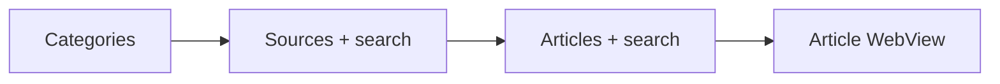

<div align="center">

# 🔦 Beacon

**Aplikasi berita Android native berbasis NewsAPI**
Kategori → Sumber → Artikel → Detail (web view)


</div>

> **Status:** tahap perencanaan. Dokumen produk, arsitektur, spesifikasi API, dan rencana test sudah siap; kode belum dibuat.

## ✨ Fitur (Rencana)

| | Fitur | Detail |
|---|---|---|
| 🗂️ | **Kategori** | Tujuh kategori resmi NewsAPI (statis) |
| 📰 | **Sumber berita** | Daftar sumber per kategori, endless scrolling (paginasi sisi klien) |
| 🧾 | **Artikel** | Artikel per sumber, endless scrolling (paginasi server) |
| 🌐 | **Detail artikel** | Dibuka di `WebView` dengan progress, error, dan fallback browser |
| 🔎 | **Pencarian** | Sumber: filter lokal. Artikel: pencarian API dengan debounce |
| 🧪 | **Kasus negatif** | Offline, kunci API salah, kuota habis, sumber hilang, JSON rusak |

## 🧭 Alur



## 🏗 Arsitektur

Multi-module Clean Architecture + MVVM (UDF), diturunkan dari Katha.

| Modul | Tanggung jawab |
|---|---|
| `:app` | Shell, navigasi (Navigation 3), `startKoin` |
| `:core:common` | `NetworkResult`, `NewsError`, `DispatcherProvider`, formatter |
| `:core:network` | Retrofit, OkHttp, Gson, `NewsApiService`, DTO, parser error |
| `:core:ui` | Tema, komponen bersama, `SearchField` |
| `:domain` | Model, `NewsRepository`, use case, `domainModule` |
| `:data` | Repository, mapper, `SourcesCache`, `PagingSource` |
| `:feature:categories` `sources` `articles` `articleweb` | Layar dan ViewModel |

Namespace: `com.halimjr11.beacon`.

## 🚀 Mulai Cepat (setelah kode tersedia)

1. Dapatkan API key di [newsapi.org](https://newsapi.org/register).
2. Tambahkan ke `local.properties` (file ini di-ignore Git):
   ```properties
   NEWS_API_KEY=your_key_here
   ```
3. Build dan jalankan:
   ```bash
   ./gradlew assembleDebug
   ./gradlew testDebugUnitTest
   ```

> ⚠️ Paket **Developer** NewsAPI: 100 request/hari, artikel tertunda 24 jam, hanya untuk development/testing. Rilis publik membutuhkan paket berbayar.

## 📚 Dokumentasi

- 📋 [Product Requirements (PRD)](docs/product_requirements_document_prd.md)
- 🏛 [Arsitektur & ADR](docs/architecture_engineering_decisions.md)
- 🌐 [Spesifikasi API NewsAPI](docs/newsapi_specification.md)
- ✅ [Test Plan & QA](docs/test_plan_and_qa.md)

## 🚧 Status

- [x] PRD, arsitektur, spesifikasi API, test plan
- [ ] Bootstrap proyek dari template Katha
- [ ] `:core:*`, `:domain`, `:data`
- [ ] Layar kategori, sumber, artikel, dan web view
- [ ] Unit test dan QA manual
- [ ] Compose UI test dan instrumented test (menyusul)
