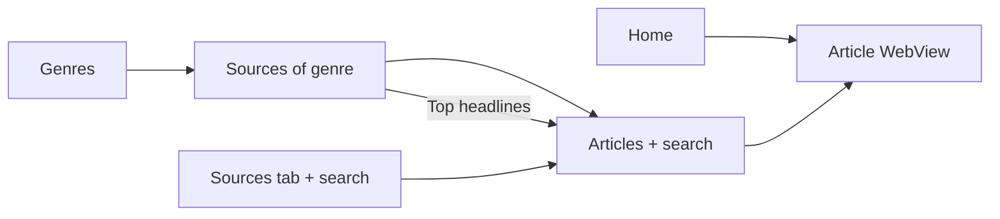

<div align="center">

# 🔦 Beacon

**Aplikasi berita Android native berbasis NewsAPI**
Home (highlight) · Genres → Sumber → Artikel · Sources → Artikel → Detail (web view)


</div>

> **Status:** aplikasi sudah berjalan (Home, Genres, Sources, Artikel, WebView, offline-first) dan sudah dicoba di emulator dengan NewsAPI asli. Daftar lengkap ada di bagian [Status](#-status).

## ✨ Fitur

| | Fitur | Detail |
|---|---|---|
| 🏠 | **Home** | Carousel highlight + daftar headline terbaru, pull-to-refresh |
| 🗂️ | **Genres** | Tujuh genre resmi NewsAPI (statis); tap genre → sumber genre itu → artikel; chip "Top headlines" untuk headline genre |
| 📰 | **Sources** | Tab terpisah: chip kategori + pencarian, daftar sumber per kategori, endless scrolling dari Room (diisi sekali per kategori, TTL 24 jam) |
| 🧾 | **Artikel** | Artikel per sumber, endless scrolling (Paging 3 + `RemoteMediator`, TTL 1 jam) |
| 📴 | **Offline-first** | Room sebagai sumber kebenaran; daftar tetap tampil saat offline dengan banner, hemat kuota API |
| 🌐 | **Detail artikel** | Dibuka di `WebView` dengan progress, error, dan fallback browser |
| 🔎 | **Pencarian** | Sumber: filter lokal. Artikel: pencarian API dengan debounce |
| 🧪 | **Kasus negatif** | Offline, kunci API salah, kuota habis, sumber hilang, JSON rusak |

## 🧭 Alur



## 🏗 Arsitektur

Multi-module Clean Architecture + MVVM (UDF), offline-first: **Room** menyimpan data, **Retrofit** mengisinya lewat `RemoteMediator`, **Paging 3** menampilkannya.

| Modul | Tanggung jawab |
|---|---|
| `:app` | Shell, navigasi (Navigation 3), `startKoin` |
| `:core:common` | `NetworkResult`, `NewsError`, `DispatcherProvider`, formatter |
| `:core:database` | Room: entity, DAO (`PagingSource`), `remote_keys` |
| `:core:network` | Retrofit, OkHttp, Gson, `NewsApiService`, DTO, parser error |
| `:core:ui` | Tema, komponen bersama, `SearchField` |
| `:domain` | Model, `NewsRepository`, use case, `domainModule` |
| `:data` | Repository, mapper, `SourcesRemoteMediator`, `ArticlesRemoteMediator` |
| `:feature:home` `categories` (Genres) `sources` `articles` `articleweb` | Layar dan ViewModel |

Namespace: `com.halimjr11.beacon`.

Konfigurasi build dipusatkan di `build-logic`; penjelasannya ada di [Build & Dependensi](#-build--dependensi-build-logic).

## 🧱 Build & Dependensi (`build-logic`)

Dengan 12 modul, mengulang SDK level, versi Java, JUnit, Compose BOM, dan Koin di tiap `build.gradle.kts` cepat melenceng. Beacon memusatkannya di dua tempat:

1. **`gradle/libs.versions.toml`**: satu-satunya tempat versi dan koordinat library.
2. **`build-logic/`**: *included build* berisi **plugin konvensi**. Modul cukup menulis satu baris plugin dan mewarisi seluruh konfigurasi standar.

### Cara kerjanya

```text
settings.gradle.kts            pluginManagement { includeBuild("build-logic") }
        │
        ▼
build-logic/                   dikompilasi lebih dulu, hasilnya dipakai semua modul
├── settings.gradle.kts        memakai katalog yang SAMA: ../gradle/libs.versions.toml
├── build.gradle.kts           `kotlin-dsl`; classpath = plugin Gradle yang akan diterapkan
└── src/main/kotlin/
    ├── BeaconBuild.kt                          konstanta (SDK, JVM, namespace) + helper katalog
    ├── beacon.android.library.gradle.kts       dasar semua library
    ├── beacon.android.library.compose.gradle.kts   + Compose
    ├── beacon.android.feature.gradle.kts       + aturan modul fitur
    ├── beacon.android.room.gradle.kts          + Room 3, KSP, ekspor skema
    ├── beacon.android.koin.gradle.kts          Koin Annotations + KSP compiler
    └── beacon.android.application.gradle.kts   shell `:app`
```

Setiap file `*.gradle.kts` adalah *precompiled script plugin*: **nama file = id plugin** (`beacon.android.feature.gradle.kts` → `id("beacon.android.feature")`). Plugin ini memakai API Gradle yang sama dengan `build.gradle.kts` biasa, tetapi dapat dibagi ke banyak modul.

### Plugin konvensi

| Plugin | Dipakai oleh | Isi |
|---|---|---|
| `beacon.android.library` | `:core:common`, `:core:network`, `:domain`, `:data` | AGP library, `compileSdk`/`minSdk`, Java 17, namespace otomatis, JUnit 5 untuk test lokal, dependensi `androidTest` (AndroidX Test, Espresso) |
| `beacon.android.library.compose` | `:core:ui` | Library + plugin Compose, Compose BOM, bundle Compose, `ui-test-junit4` dan `ui-test-manifest` |
| `beacon.android.feature` | `:feature:*` | Library Compose + `:core:common`, `:core:ui`, `:domain`, Koin, lifecycle, `paging-testing` + **penjaga batas modul** (lihat bawah) |
| `beacon.android.koin` | modul yang mendeklarasikan DI (otomatis di `beacon.android.feature`) | KSP + `koin-annotations` + `koin-ksp-compiler` |
| `beacon.android.room` | `:core:database` | Library + KSP + plugin `androidx.room3`, `room3-runtime`/`room3-paging` (`api`), skema diekspor ke `schemas/` |
| `beacon.android.application` | `:app` | Application, Compose, plugin serialization (untuk key Navigation 3), JUnit 5, dependensi `androidTest` |

Contoh `build.gradle.kts` sebuah modul fitur (seluruh isinya):

```kotlin
plugins {
    id("beacon.android.feature")
}
```

### Konstanta dan helper (`BeaconBuild.kt`)

```kotlin
object BeaconBuild { COMPILE_SDK = 37; TARGET_SDK = 37; MIN_SDK = 24; JVM = 17; NAMESPACE_ROOT = "com.halimjr11.beacon" }
```

- Ubah SDK atau versi Java **sekali di sini**, semua modul ikut.
- **Namespace otomatis** dari nama modul: `:core:network` → `com.halimjr11.beacon.network` (nama modul harus unik).
- Helper `catalog.lib("alias")` dan `catalog.bundle("alias")` membaca katalog dari dalam script plugin (nama `catalog`, bukan `libs`, agar tidak bentrok dengan accessor `libs` bawaan Gradle).

### Penjaga batas modul

`beacon.android.feature` **menggagalkan build** bila sebuah fitur bergantung pada `:data`, `:core:network`, atau `:core:database`:

```text
:feature:articles must not depend on :data (features use only :domain, :core:ui, :core:common)
```

Jadi aturan arsitektur (fitur hanya bergantung pada `:domain`, `:core:ui`, `:core:common`) ditegakkan oleh build, bukan hanya konvensi. Lihat matriks dependensi di [Arsitektur](docs/architecture_engineering_decisions.md#b-strict-dependency-matrix) dan ADR-014.

### Tugas umum

| Tujuan | Langkah |
|---|---|
| Menaikkan versi library | Ubah `[versions]` di `gradle/libs.versions.toml`. Selesai. |
| Menambah library | Tambah baris di `[libraries]` (dan ke `[bundles]` bila dipakai bersama), lalu `implementation(libs.nama.alias)` di modul yang memerlukan. |
| Menambah modul fitur | `include(":feature:nama")` di `settings.gradle.kts`, buat `feature/nama/build.gradle.kts` berisi satu baris `id("beacon.android.feature")`, tambahkan `implementation(project(":feature:nama"))` di `:app`. |
| Mengubah SDK/Java | Ubah `BeaconBuild`. |
| Menaikkan AGP/Kotlin/KSP/Room | Ubah `[versions]`; artefak plugin untuk `build-logic` sudah merujuk versi yang sama (`build-*-plugin` di `[libraries]`). |

### Hal yang perlu diketahui

- **Plugin yang masuk lewat `build-logic` tidak terlihat oleh blok `plugins {}` modul.** Terapkan di dalam plugin konvensi (contoh: plugin serialization diterapkan di `beacon.android.application`, bukan di `app/build.gradle.kts`).
- **`build.gradle.kts` di root sengaja hanya berisi komentar**; plugin tidak dideklarasikan di sana agar classpath tidak bentrok dengan `build-logic`.
- **AGP 9 sudah membawa Kotlin** (tanpa plugin `org.jetbrains.kotlin.android`); `kotlin { jvmToolchain(17) }` diatur di plugin konvensi.
- **Room 3 hanya mendukung KSP** (paket `androidx.room3`); DAO yang mengembalikan `PagingSource` membutuhkan `@DaoReturnTypeConverters(PagingSourceDaoReturnTypeConverter::class)`.
- **Test lokal memakai JUnit 5** (`useJUnitPlatform()`); **`androidTest` tetap JUnit 4** dan nama fungsi test tidak boleh berisi spasi (DEX di minSdk 24).
- **Heap Gradle 4 GB** (`gradle.properties`): merakit APK uji dengan Compose butuh lebih dari 2 GB.
- Setelah mengubah `build-logic`, Gradle mengompilasinya ulang otomatis; bila perilaku aneh, jalankan `./gradlew --stop` lalu ulangi.

## 💉 Dependency Injection (Koin Annotations)

Koin 4.2.2 dengan anotasi dan KSP. Tiap modul Gradle yang menyediakan dependensi punya satu `@Module`; `:app` menggabungkannya di `AppModules.kt`.

```kotlin
// Objek yang dibangun dengan kode: fungsi di @Module
@Module
class NetworkModule {

    @Single
    fun okHttpClient(): OkHttpClient = ...

    @Single
    fun retrofit(client: OkHttpClient): Retrofit = ...
}

// Class biasa: anotasi langsung, ditemukan oleh @ComponentScan pada modulnya
@Factory
class GetSourcesUseCase(private val repository: NewsRepository)

@Single(binds = [NewsRepository::class])
class NewsRepositoryImpl(...)

@KoinViewModel
class ArticlesViewModel(
    @InjectedParam
    private val feed: NewsFeed,
    getArticles: GetArticlesUseCase,
) : ViewModel()
```

| Modul | `@Module` | Menyediakan |
|---|---|---|
| `:core:common` | `CommonModule` | `DispatcherProvider` |
| `:core:network` | `NetworkModule` | `OkHttpClient`, `Retrofit`, `NewsApiService` |
| `:core:database` | `DatabaseModule` | `BeaconDatabase`, tiga DAO |
| `:domain` | `DomainModule` | use case (`@Factory`) |
| `:data` | `DataModule` | `NewsRepository`, `TransactionRunner`, `CacheRetention`, `Clock` |
| `:feature:home` `sources` `articles` | `HomeModule` `SourcesModule` `ArticlesModule` | ViewModel (`@KoinViewModel`) |

- **Parameter runtime:** `koinViewModel(key = "...", parameters = { parametersOf(feed) })` dan `@InjectedParam` pada konstruktor.
- **Start-up:** `startKoin` dengan `allowOverride(false)` (tipe ganda gagal saat start) dan logger Koin hanya di debug.
- **Modul baru:** beri `@Module` + `@ComponentScan` di paketnya, tambahkan `id("beacon.android.koin")` (fitur sudah otomatis), lalu daftarkan `XModule().module` di `AppModules.kt`. `KoinModulesTest` gagal bila ada dependensi yang tidak terpenuhi.

## 🚀 Mulai Cepat

1. Dapatkan API key di [newsapi.org](https://newsapi.org/register).
2. Tambahkan ke `local.properties` (file ini di-ignore Git):
   ```properties
   NEWS_API_KEY=your_key_here
   ```
3. Build dan jalankan:
   ```bash
   ./gradlew assembleDebug
   ./gradlew testDebugUnitTest                      # 153 unit test (JUnit 5)
   ./gradlew :core:database:connectedDebugAndroidTest   # instrumented (emulator/perangkat), tiap modul punya src/androidTest
   ```

**Tanpa API key (QA/mock):** jalankan `python3 docs/mock/mock_server.py`, isi `NEWS_API_KEY=mock` dan `NEWS_API_BASE_URL=http://localhost:8099/v2/` di `local.properties`, lalu `adb reverse tcp:8099 tcp:8099`. Hanya build debug yang membaca base URL ini.

> ⚠️ Paket **Developer** NewsAPI: 100 request/hari, artikel tertunda 24 jam, hanya untuk development/testing. Rilis publik membutuhkan paket berbayar.

## 📚 Dokumentasi

- 📋 [Product Requirements (PRD)](docs/product_requirements_document_prd.md)
- 🏛 [Arsitektur & ADR](docs/architecture_engineering_decisions.md)
- 🌐 [Spesifikasi API NewsAPI](docs/newsapi_specification.md)
- ✅ [Test Plan & QA](docs/test_plan_and_qa.md)

## 🚧 Status

- [x] PRD, arsitektur, spesifikasi API, test plan
- [x] Bootstrap proyek: modul Gradle kosong dan tema (`BeaconTheme`)
- [x] Setup build bersama: `build-logic`, katalog versi, Room 3 + KSP di `:core:database`
- [x] `:core:*` (termasuk `:core:database`), `:domain`, `:data`
- [x] Offline-first fase 1: Room + mediator sumber
- [x] Offline-first fase 2 (data): mediator artikel, retensi (`CacheRetention`)
- [x] Offline-first fase 2 (UI): banner offline/kuota (`CacheBanner`), `CacheRetention.purge()` dipanggil saat start
- [x] Layar Home, Genres, Sources, artikel, dan web view (smoke test di emulator dengan server tiruan)
- [x] Verifikasi dengan `NEWS_API_KEY` asli (Home, Genres, Sources, artikel, WebView; lihat API Spec §0)
- [ ] QA manual penuh (sekitar 19 dari 64 kasus sudah dijalankan, lihat Test Plan)
- [x] Unit test berparameter (JUnit 5) dan instrumented test (Room, Compose UI, Espresso, 134 tes)
