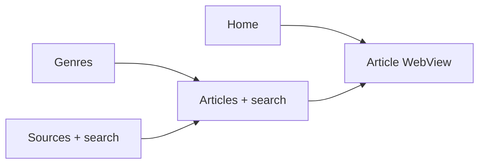

<div align="center">

# 🔦 Beacon

**Aplikasi berita Android native berbasis NewsAPI**
Home (highlight) · Genres · Sources → Artikel → Detail (web view)


</div>

> **Status:** tahap perencanaan. Dokumen produk, arsitektur, spesifikasi API, dan rencana test sudah siap; kode belum dibuat.

## ✨ Fitur (Rencana)

| | Fitur | Detail |
|---|---|---|
| 🏠 | **Home** | Carousel highlight + daftar headline terbaru, pull-to-refresh |
| 🗂️ | **Genres** | Tujuh genre resmi NewsAPI (statis), tap untuk headline genre |
| 📰 | **Sources** | Tab terpisah: chip kategori + pencarian, daftar sumber per kategori, endless scrolling dari Room (diisi sekali per kategori, TTL 24 jam) |
| 🧾 | **Artikel** | Artikel per sumber, endless scrolling (Paging 3 + `RemoteMediator`, TTL 1 jam) |
| 📴 | **Offline-first** | Room sebagai sumber kebenaran; daftar tetap tampil saat offline dengan banner, hemat kuota API |
| 🌐 | **Detail artikel** | Dibuka di `WebView` dengan progress, error, dan fallback browser |
| 🔎 | **Pencarian** | Sumber: filter lokal. Artikel: pencarian API dengan debounce |
| 🧪 | **Kasus negatif** | Offline, kunci API salah, kuota habis, sumber hilang, JSON rusak |

## 🧭 Alur



## 🏗 Arsitektur

Multi-module Clean Architecture + MVVM (UDF), offline-first: **Room** menyimpan data, **Retrofit** mengisinya lewat `RemoteMediator`, **Paging 3** menampilkannya.

| Modul | Tanggung jawab |
|---|---|
| `:app` | Shell, navigasi (Navigation 3), `startKoin` |
| `:core:common` | `NetworkResult`, `NewsError`, `DispatcherProvider`, formatter |
| `:core:database` | Room: entity, DAO (`PagingSource`), `remote_keys` |
| `:core:network` | Retrofit, OkHttp, Gson, `NewsApiService`, DTO, parser error |
| `:core:ui` | Tema, komponen bersama, `SearchField` |
| `:domain` | Model, `NewsRepository`, use case, `domainModule` |
| `:data` | Repository, mapper, `SourcesRemoteMediator`, `ArticlesRemoteMediator` |
| `:feature:home` `categories` (Genres) `sources` `articles` `articleweb` | Layar dan ViewModel |

Namespace: `com.halimjr11.beacon`.

**Build bersama:** versi di `gradle/libs.versions.toml`; konfigurasi modul di included build `build-logic` (`beacon.android.library|library.compose|feature|room|application`). Modul fitur cukup `id("beacon.android.feature")`, dan build gagal bila fitur bergantung pada `:data`, `:core:network`, atau `:core:database`.

## 🚀 Mulai Cepat (setelah kode tersedia)

1. Dapatkan API key di [newsapi.org](https://newsapi.org/register).
2. Tambahkan ke `local.properties` (file ini di-ignore Git):
   ```properties
   NEWS_API_KEY=your_key_here
   ```
3. Build dan jalankan:
   ```bash
   ./gradlew assembleDebug
   ./gradlew testDebugUnitTest
   ```

> ⚠️ Paket **Developer** NewsAPI: 100 request/hari, artikel tertunda 24 jam, hanya untuk development/testing. Rilis publik membutuhkan paket berbayar.

## 📚 Dokumentasi

- 📋 [Product Requirements (PRD)](docs/product_requirements_document_prd.md)
- 🏛 [Arsitektur & ADR](docs/architecture_engineering_decisions.md)
- 🌐 [Spesifikasi API NewsAPI](docs/newsapi_specification.md)
- ✅ [Test Plan & QA](docs/test_plan_and_qa.md)

## 🚧 Status

- [x] PRD, arsitektur, spesifikasi API, test plan
- [x] Bootstrap proyek: modul Gradle kosong dan tema (`BeaconTheme`)
- [x] Setup build bersama: `build-logic`, katalog versi, Room 3 + KSP di `:core:database`
- [x] `:core:*` (termasuk `:core:database`), `:domain`, `:data`
- [x] Offline-first fase 1: Room + mediator sumber
- [x] Offline-first fase 2 (data): mediator artikel, retensi (`CacheRetention`)
- [ ] Offline-first fase 2 (UI): banner offline di layar, panggil `CacheRetention.purge()` saat start
- [x] Layar Home, Genres, Sources, artikel, dan web view (belum dicoba di perangkat)
- [ ] Verifikasi di emulator dengan `NEWS_API_KEY` asli
- [ ] Unit test dan QA manual
- [ ] Compose UI test dan instrumented test (menyusul)
