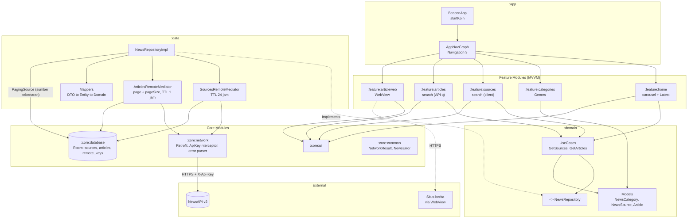
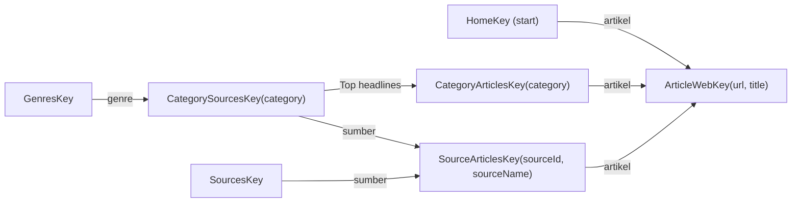
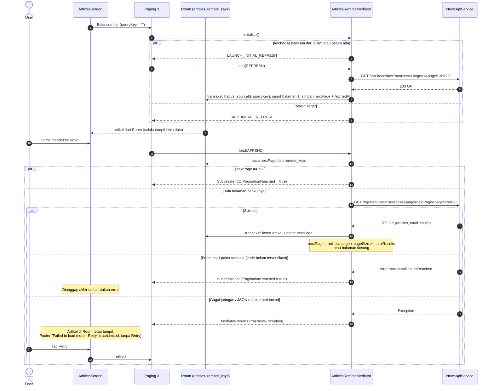
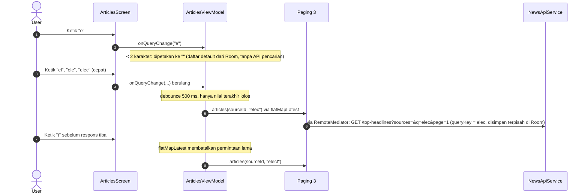
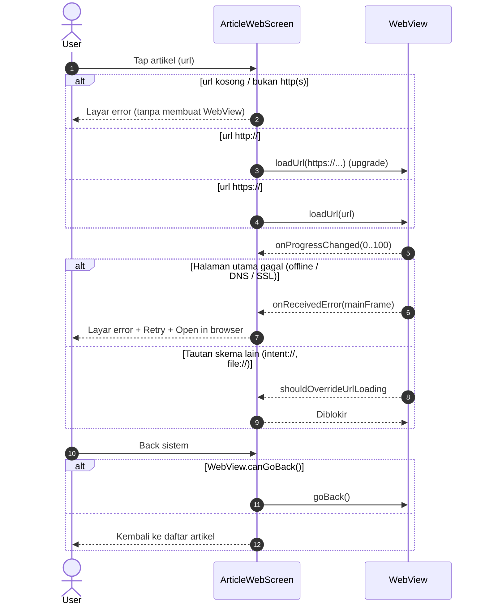

# Architecture & Engineering Decisions — Beacon (`ARCHITECTURE.md`)

## 1. Multi-Module Architecture & Dependency Rules

Aplikasi **Beacon** (`com.halimjr11.beacon`) menerapkan **Multi-Module Clean Architecture + MVVM** dengan *Unidirectional Data Flow (UDF)*. Struktur dan aturannya disesuaikan dengan sifat NewsAPI (sources tanpa paginasi, kuota 100 request/hari, detail lewat `WebView`) dan pendekatan **offline-first**: Room adalah sumber kebenaran tunggal untuk daftar, Retrofit hanya mengisi Room lewat `RemoteMediator` (ADR-013).

### A. Struktur Direktori Multi-Module

```text
Beacon/
├── app/                            # Application shell, MainActivity, AppNavGraph (Navigation 3), startKoin { ... }
├── core/
│   ├── common/                     # Android library tanpa UI: NetworkResult<T> + NewsError, DispatcherProvider, formatter tanggal
│   ├── database/                   # Android Library (Room): BeaconDatabase, entity, DAO (PagingSource), RemoteKeys, databaseModule
│   ├── network/                    # Android Library: OkHttp, ApiKeyInterceptor, Retrofit, NewsApiService, DTO, parser error, networkModule
│   └── ui/                         # Android Compose: BeaconTheme, FullScreenLoading, FullScreenError, PagingFooter, RemoteImage, SearchField
├── domain/                         # Android library tanpa UI (logika murni): Models, NewsRepository, UseCases, domainModule
├── data/                           # Android Library: NewsRepositoryImpl, Mappers (DTO→Entity→Domain), SourcesRemoteMediator, ArticlesRemoteMediator, dataModule
└── feature/
    ├── home/                       # HomeScreen (carousel highlight + Latest), HomeViewModel, homeModule
    ├── categories/                 # GenresScreen (7 genre, statis)
    ├── sources/                    # SourcesScreen (tab: chip kategori + search lokal), CategorySourcesScreen (satu genre), SourcesViewModel(initialCategory), sourcesModule
    ├── articles/                   # ArticlesScreen untuk feed genre atau sumber, ArticlesViewModel (+search, debounce), articlesModule
    └── articleweb/                 # ArticleWebScreen (WebView), WebUrlPolicy (fungsi murni: validasi, upgrade https, izin skema), ArticleWebViewModel (opsional)
```

Namespace Gradle: `com.halimjr11.beacon` (app) dan `com.halimjr11.beacon.<modul>` (modul lain, mis. `com.halimjr11.beacon.network`).

### B. Strict Dependency Matrix
* `:app` → mengoordinasikan seluruh modul untuk merakit navigasi dan mendaftarkan seluruh Koin modules.
* `:feature:*` → **hanya** `:domain`, `:core:ui`, `:core:common`. **Dilarang** mengakses `:data` atau `:core:network`.
* `:data` → `:domain`, `:core:network`, `:core:database`, `:core:common`. Hanya `:data` yang boleh menyentuh Room dan Retrofit.
* `:core:database` → tidak bergantung ke modul lain (entity dan DAO murni; mapper ke domain berada di `:data`).
* `:domain` → `:core:common` (yang meng-expose `kotlinx-coroutines-core` dan bundle Koin lewat `api`) dan `androidx.paging:paging-common`. Tanpa Retrofit/OkHttp dan tanpa class Android.
* `:core:network` → `:core:common`.

### C. Modular System Architecture Diagram



### D. Strategi Koin Multi-Module
* **Desentralisasi:** `networkModule`, `dataModule`, `domainModule` (di `:domain`), `sourcesModule`, `articlesModule` (dan `articleWebModule` bila ada ViewModel).
* **Parameter runtime:** `viewModel { params -> SourcesViewModel(category = params.get(), getSources = get()) }` dipanggil dengan `parametersOf(...)`; kunci ViewModel unik per kategori/sumber (`key = "sources_$category"`).
* **Verifikasi:** `KoinModulesTest` di `:app` menggabungkan seluruh modul (`includes(...)`) dan menjalankan `verify(extraTypes = listOf(Int::class, String::class))`.

### E. Navigasi (Navigation 3)


* Alur US2 dipertahankan: Genres → `CategorySourcesScreen` (sumber satu genre, ViewModel diberi kategori lewat `parametersOf`) → artikel sumber. Chip "Top headlines" di layar itu membuka `CategoryArticlesKey`.
* Tiga tab (`HomeKey`, `GenresKey`, `SourcesKey`) memakai `NavigationBar`. Memilih tab mengganti back stack menjadi `[Home, tab]`, sehingga Back dari tab mana pun kembali ke Home lalu keluar. State tab tidak dipertahankan saat berpindah tab (data tetap ada karena dibaca dari Room).
* `NavDisplay` memakai dekorator `rememberSaveableStateHolderNavEntryDecorator` dan `rememberViewModelStoreNavEntryDecorator` supaya ViewModel terikat ke entri back stack.
* Key `@Serializable` (`NavKey`) berada di `:app`; layar fitur menerima *callback* navigasi (tidak bergantung pada library navigasi). Bottom bar disembunyikan di layar artikel dan detail.

---

## 2. Model Domain & Kontrak

```kotlin
enum class NewsCategory(val apiValue: String, val displayName: String) {
    Business("business", "Business"), Entertainment("entertainment", "Entertainment"),
    General("general", "General"), Health("health", "Health"), Science("science", "Science"),
    Sports("sports", "Sports"), Technology("technology", "Technology")
}

data class NewsSource(val id: String = "", val name: String = "", val description: String = "",
                      val category: String = "", val language: String = "", val country: String = "")

data class Article(val id: String = "", val sourceName: String = "", val author: String = "",
                   val title: String = "", val description: String = "", val url: String = "",
                   val imageUrl: String = "", val publishedAt: String = "", val content: String = "")

sealed interface NewsFeed {
    data object Headlines : NewsFeed                       // Home: top-headlines?country=us
    data class Category(val category: NewsCategory) : NewsFeed   // ?category=<x>
    data class Source(val id: String) : NewsFeed                 // ?sources=<id>
}

interface NewsRepository {
    fun sources(category: NewsCategory, query: String): Flow<PagingData<NewsSource>>
    fun articles(feed: NewsFeed, query: String): Flow<PagingData<Article>>
}
```
Semua properti non-null dengan default; model berada satu file per class. Use case, satu file masing-masing: `GetSourcesUseCase`, `GetArticlesUseCase`. Kategori statis dibaca langsung dari `NewsCategory.entries` (tanpa use case, karena tidak ada logika).

### Model Error (`:core:common`)
```kotlin
sealed interface NewsError {
    data object Offline : NewsError
    data object InvalidApiKey : NewsError
    data object RateLimited : NewsError
    data object SourceNotFound : NewsError
    data class BadRequest(val message: String) : NewsError
    data object Server : NewsError
    data object Parse : NewsError
    data class Unknown(val message: String) : NewsError
    data object EndOfResults : NewsError   // maximumResultsReached: akhir daftar, bukan kegagalan
}
```
`NetworkResult.Error` membawa `NewsError`; UI memetakan tipe ke pesan dan aksi (PRD §FR-07). Parser di `:core:network` membaca `code` dari body error.

**Jalur error ke UI (Paging).** `NewsRepository` hanya mengembalikan `Flow<PagingData>`, sedangkan Paging melaporkan kegagalan sebagai `Throwable` di `LoadState.Error`. Jembatannya:
```kotlin
class NewsException(val error: NewsError) : Exception()   // :core:common
fun Throwable.toNewsError(): NewsError =                   // :core:common
    (this as? NewsException)?.error ?: NewsError.Unknown(message.orEmpty())
```
* `safeCall` (repository) menghasilkan `NetworkResult`; kedua `RemoteMediator` membuka hasilnya: `Success` → simpan ke Room, `Error(e)` → `MediatorResult.Error(NewsException(e))`. `CancellationException` tetap di-*rethrow*.
* UI membaca `loadState` → `(error as Throwable).toNewsError()` lalu memetakan ke pesan dan aksi FR-07. Karena data lokal tetap tampil, error hanya menjadi **layar penuh** bila `itemCount == 0`; bila sudah ada data, error menjadi **banner/footer** (lihat §2 *Model Offline*).

### Model Offline (Room, `:core:database`)
```kotlin
@Entity(tableName = "sources")
data class SourceEntity(@PrimaryKey val id: String, val name: String, val description: String,
                        val category: String, val language: String, val country: String)

@Entity(tableName = "articles",
        indices = [Index(value = ["feedId", "queryKey", "url"], unique = true)])
data class ArticleEntity(@PrimaryKey(autoGenerate = true) val rowId: Long = 0,
                         val feedId: String, val queryKey: String, val url: String,
                         val sourceName: String, val author: String, val title: String,
                         val description: String, val imageUrl: String,
                         val publishedAt: String, val content: String)

@Entity(tableName = "remote_keys")
data class RemoteKeyEntity(@PrimaryKey val key: String,   // "sources:<category>:<lang>" atau "articles:<feedId>:<queryKey>"
                           val nextPage: Int?, val fetchedAt: Long)
```
* `ORDER BY rowId` menjaga urutan API; `rowId` dipakai sebagai kunci item Compose (menyelesaikan duplikat `url` antar halaman, AC 6.3).
* `feedId`: `top` (Home), `category:<x>`, atau `source:<id>`.
* `queryKey` = query yang sudah di-`trim` dan di-*lowercase*; `""` untuk daftar default.
* DAO mengembalikan `PagingSource<Int, Entity>`; pencarian sumber memakai `WHERE category = :c AND (name LIKE :q OR description LIKE :q)`.
* `fetchedAt` memakai jam yang dapat disuntik (`Clock`/lambda) agar TTL bisa diuji.

---

## 3. Sequence Diagrams

### A. Sumber: Room sebagai Sumber Kebenaran, TTL, Pencarian

```mermaid
sequenceDiagram
    autonumber
    actor User
    participant UI as SourcesScreen
    participant VM as SourcesViewModel
    participant Pager as Paging 3 (20/halaman)
    participant DB as Room (sources, remote_keys)
    participant Med as SourcesRemoteMediator
    participant API as NewsApiService

    User->>UI: Pilih kategori
    UI->>VM: init(category)
    VM->>Pager: sources(category, query = "")
    Pager->>Med: initialize()
    Med->>DB: baca remote_keys(sources:category:en)
    alt Belum ada atau fetchedAt lebih tua dari 24 jam
        Med-->>Pager: LAUNCH_INITIAL_REFRESH
        Pager->>Med: load(REFRESH)
        Med->>API: GET /top-headlines/sources?category=&language=en
        alt 200 OK
            API-->>Med: daftar sumber (semua)
            Med->>DB: transaksi: hapus kategori lama, insert baru, simpan fetchedAt
            Med-->>Pager: Success(endOfPaginationReached = true)
        else Gagal (offline / 401 / 429 / JSON rusak)
            API-->>Med: Exception
            Med-->>Pager: MediatorResult.Error(NewsException)
            Note over UI: Cache kosong: layar error + Retry.<br/>Cache ada: tampil data + banner (tanpa menghapus data)
        end
    else Masih segar
        Med-->>Pager: SKIP_INITIAL_REFRESH (tanpa panggilan API)
    end
    Pager->>DB: PagingSource (LIMIT 20 per halaman)
    DB-->>UI: items[0..19]; scroll menambah 20 berikutnya dari DB
    User->>UI: Ketik "bbc"
    UI->>VM: onQueryChange("bbc")
    VM->>Pager: sources(category, "bbc") (query LIKE di Room; TTL masih segar, tanpa API)
```

### B. Artikel: Mediator, Endless Scroll, Offline, Akhir Daftar



### C. Pencarian Artikel: Debounce dan Pembatalan



### D. Detail Artikel: Pemuatan WebView dan Error



---

## 4. Architecture Decision Records (ADR)

### ADR-001: Koin 4.2.2 dengan Constructor DSL
* **Context:** Proyek membutuhkan DI ringan lintas modul, mendukung `ViewModel` dengan parameter runtime.
* **Decision:** Koin (`singleOf`, `factoryOf`, `viewModel { params -> }`) terdesentralisasi per modul; `domainModule` berada di `:domain`.
* **Consequences:** (+) tanpa KSP/KAPT, build cepat. (−) resolusi saat runtime. *(Mitigasi: `KoinModulesTest` dengan `verify()`.)*

### ADR-002: Paging 3 untuk Sumber dan Artikel
* **Context:** US6 mewajibkan *endless scrolling* di sumber dan artikel, lengkap dengan kasus error.
* **Decision:** Keduanya memakai Room `PagingSource` + `RemoteMediator` (ADR-013) → `Flow<PagingData<T>>` (`cachedIn(viewModelScope)`) → `collectAsLazyPagingItems()`.
* **Consequences:** (+) state `Refresh/Append`, retry, dan pembatalan sudah standar. (−) perlu footer dan banner khusus di `:core:ui`.

### ADR-003: Paginasi Sisi Klien untuk Sumber (Cache di Memori) — *Digantikan oleh ADR-013*
* **Context:** `/top-headlines/sources` tidak punya `page`/`pageSize` dan tidak punya `q`. Kuota hanya 100 request/hari.
* **Decision:** `SourcesCache` mengambil daftar sekali per kategori (dan bahasa), lalu `SourcesPagingSource` mengiris 20 item per halaman dari cache; pencarian memfilter daftar di memori sebelum diiris.
* **Consequences:** (+) memenuhi US6 dan US5 tanpa memboroskan kuota; rotasi dan kembali ke layar tidak memanggil API. (−) cache hilang saat proses mati (diterima; tanpa database sesuai ADR-008). Kegagalan tidak di-cache.
* **Status:** digantikan ADR-013. Yang tetap berlaku: endpoint sources diambil sekali per kategori; paginasi 20 item kini dilakukan Room.

### ADR-004: Model Error Bertipe yang Dibaca dari Body
* **Context:** NewsAPI mengembalikan `{status, code, message}`; dokumentasi tidak memetakan kode ke status HTTP.
* **Decision:** Parser di `:core:network` membaca `code` dari body dan memetakan ke `NewsError`; status HTTP hanya cadangan. Repository memakai pola `safeCall` yang me-*rethrow* `CancellationException` dan menangkap `Exception` lain (JSON rusak dari Gson adalah `RuntimeException`).
* **Consequences:** (+) kasus negatif US7 tertangani dengan pesan tepat; pembatalan tidak berubah menjadi error. (−) kode yang belum terverifikasi (`maximumResultsReached`) harus diuji dengan panggilan nyata.

### ADR-005: Gson sebagai Converter JSON
* **Decision:** Retrofit + `GsonConverterFactory`; semua field DTO nullable dengan default `null` (supaya ada constructor tanpa argumen dan Gson tidak melewati nilai default); `@SerializedName` di baris sendiri; aturan R8 DTO di `consumer-rules.pro`.
* **Consequences:** (+) sederhana dan umum dipakai di Android. (−) berbasis reflection dan tidak mengenal nullability Kotlin; ditutup dengan DTO nullable dan mapper yang defensif.

### ADR-006: Artikel dari `top-headlines` per Sumber
* **Decision:** `GET /top-headlines?sources=<id>&q=&page=&pageSize=20`. `sources` tidak boleh digabung `country`/`category`; alur kita memakai kategori hanya di layar sumber.
* **Consequences:** (+) satu endpoint untuk daftar dan pencarian. (−) hasil dibatasi paket; `/everything` (pencarian lebih dalam) ditunda.

### ADR-007: WebView yang Diperketat dengan Fallback Browser
* **Context:** US4 mewajibkan detail di web view; URL artikel bisa `http://`; Beacon memblokir cleartext.
* **Decision:** `WebView` dengan JavaScript aktif (dibutuhkan situs berita), `allowFileAccess=false`, `allowContentAccess=false`, mixed content ditolak, hanya skema `http/https`, progress dari `WebChromeClient`, error main-frame dari `WebViewClient.onReceivedError`, `BackHandler` untuk riwayat web, `destroy()` saat keluar. `http://` dicoba sebagai `https://`; bila gagal ditawarkan **Open in browser**.
* **Consequences:** (+) aman tanpa melonggarkan cleartext untuk seluruh aplikasi. (−) sebagian situs `http`-only tidak bisa dimuat di dalam aplikasi.

### ADR-008: Tanpa Database Lokal pada Iterasi Ini — *Digantikan oleh ADR-013*
* **Decision (lama):** Tidak ada Room/`RemoteMediator`; cache sumber hanya di memori.
* **Status:** digantikan ADR-013 karena kuota 100 request/hari membuat cache persisten bernilai tinggi.

### ADR-009: `:core:common` dan `:domain` sebagai Android Library Tanpa UI
* **Context:** Bundle `koin-android`/`koin-androidx-compose` berupa AAR sehingga tidak bisa dikonsumsi modul JVM murni.
* **Decision:** Kedua modul adalah Android library tanpa UI; `:core:common` meng-expose coroutines dan bundle Koin lewat `api`, sehingga `domainModule` berada di `:domain`.
* **Consequences:** (+) `domainModule` dekat dengan use case-nya. (−) `:domain` bukan JVM murni; larangan memakai class Android di `:domain` menjadi konvensi, bukan batasan compiler.

### ADR-010: API Key via Header dan `local.properties`
* **Decision:** `NEWS_API_KEY` di `local.properties` (di-ignore Git) → `BuildConfig` → header `X-Api-Key` oleh `ApiKeyInterceptor`. Logging OkHttp memakai level `BASIC` di debug dan `NONE` di release; header sensitif tidak dicatat.
* **Consequences:** (+) kunci tidak masuk repo dan tidak muncul di URL. (−) kunci tetap dapat diekstrak dari APK; untuk produksi pertimbangkan proxy backend.

### ADR-011: Pencarian Artikel dengan Debounce dan `flatMapLatest`
* **Decision:** `query` di `ArticlesViewModel` → `debounce(500 ms)` → petakan query < 2 karakter (setelah `trim`) menjadi `""` (daftar default, tanpa panggilan API pencarian; sesuai AC 5.8) → `distinctUntilChanged` → `flatMapLatest { repository.articles(sourceId, it) }` → `cachedIn`. Pencarian sumber tidak memakai debounce karena murni lokal.
* **Consequences:** (+) hemat kuota, tanpa hasil basi. (−) pengujian perlu *virtual time* (`runTest` + Turbine).

### ADR-012: Struktur Modul Berbasis Lapisan dan Fitur
* **Decision:** `:core:*`, `:domain`, `:data`, `:feature:*` berbasis lapisan dan fitur; satu file per class model/use case; satu komponen daftar paging bersama di `:core:ui` bila pola loading/error/footer berulang.
* **Consequences:** (+) batas dependensi ditegakkan compiler. (−) konfigurasi Gradle awal lebih banyak (dimitigasi version catalog).

### ADR-013: Offline-First dengan Room, `RemoteMediator`, dan Retrofit
* **Context:** Kuota Developer hanya 100 request/hari dan artikel tertunda 24 jam, sehingga memuat ulang tiap kali layar dibuka memboroskan kuota tanpa data yang lebih baru. Pengguna juga ingin membaca daftar yang sudah pernah dimuat saat offline.
* **Decision:**
  * **Room adalah sumber kebenaran.** UI hanya mengamati `PagingSource` Room; Retrofit hanya menulis ke Room lewat `RemoteMediator`. Domain tetap `Flow<PagingData<T>>` sehingga `:domain` dan `:feature:*` tidak berubah.
  * **Modul `:core:database`** (Room 3 `androidx.room3`: `room3-runtime`, `room3-paging`, KSP; plugin `beacon.android.room`). Hanya `:data` yang bergantung padanya; mapper DTO → Entity → Domain berada di `:data`.
  * **`SourcesRemoteMediator`:** `initialize()` mengembalikan `SKIP_INITIAL_REFRESH` bila `remote_keys.fetchedAt` kurang dari **24 jam**. `REFRESH` mengambil seluruh daftar kategori dalam satu panggilan, mengganti baris kategori itu dalam satu transaksi, dan mengakhiri paging (`endOfPaginationReached = true`). Paginasi 20 item dan pencarian (`LIKE`) dilakukan Room, tanpa panggilan API.
  * **`ArticlesRemoteMediator`:** kunci per `(feedId, queryKey)`; TTL **1 jam** (artikel memang tertunda 24 jam, jadi TTL pendek tidak memberi data lebih baru). `REFRESH` halaman 1 menghapus baris `(sourceId, queryKey)` lama; `APPEND` membaca `nextPage` dari `remote_keys`; `PREPEND` langsung berakhir. Hapus-dan-insert serta update key selalu dalam satu `withTransaction`.
  * **Aturan error:** kegagalan tidak menghapus data lokal. Layar error penuh hanya bila `itemCount == 0`; selain itu banner "Offline, menampilkan data tersimpan" (refresh) atau footer Retry (append). `rateLimited`/`apiKeyExhausted`: tanpa *auto-retry*, tetap tampilkan cache dengan banner kuota.
  * **Pencarian artikel** tetap memanggil API (`q`) lewat `queryKey` sendiri; hasilnya ikut di-cache. Offline tanpa cache untuk query itu menampilkan error (TC-34).
  * **Retensi:** hapus artikel lebih tua dari 7 hari dan batasi total baris; skema cache boleh memakai `fallbackToDestructiveMigration` karena data dapat diambil ulang (`exportSchema = true`).
  * **Gambar:** disk cache Coil 3 menyediakan gambar offline tanpa kerja tambahan. Halaman `WebView` tetap membutuhkan internet (AC 4.2).
  * **Paging config:** `initialLoadSize = 20` (bukan default 3 halaman, yang membuat pembukaan pertama memanggil API 3 kali) dan `prefetchDistance = 5`. Karena `RemoteMediator` mengambil satu halaman lebih awal saat data Room habis, pembukaan pertama = 2 request.
  * **Fase:** (1) Room + mediator sumber; (2) mediator artikel, banner offline, retensi.
* **Consequences:** (+) hemat kuota, daftar tersedia offline, tidak ada layar kosong saat gagal, kunci item stabil lewat `rowId`. (−) `RemoteMediator` mudah salah (transaksi, kunci halaman, refresh yang membuat daftar melompat; dimitigasi TTL di `initialize()`); satu modul dan dua mapper tambahan; pengujian DAO butuh `androidTest` atau Robolectric (JUnit 4, bertentangan dengan platform JUnit 5 kecuali ditambah mesin vintage), sedangkan mediator dapat diuji dengan `paging-testing` bila DAO berada di balik interface dan diganti fake. Room 3 (3.0.3) hanya mendukung KSP dan sudah terverifikasi berjalan dengan AGP 9.5 dan KSP 2.3.x (`:core:database:kspDebugKotlin` lulus); skema diekspor ke `core/database/schemas/`.

### ADR-014: Dependency dan Konfigurasi Bersama lewat `build-logic`
* **Context:** Sepuluh modul akan mengulang SDK level, Java 17, JUnit 5, Compose BOM, dan Koin. Duplikasi membuat versi melenceng dan aturan batas modul hanya berupa konvensi.
* **Decision:**
  * **Satu sumber versi:** `gradle/libs.versions.toml` (library, bundle, dan artefak plugin Gradle untuk `build-logic`); tidak ada blok `[plugins]` maupun `plugins {}` di root.
  * **Included build `build-logic`** berisi *precompiled script plugin* dan konstanta `BeaconBuild` (compileSdk/targetSdk 37, minSdk 24, JVM 17, namespace `com.halimjr11.beacon.<modul>` otomatis).
  * **Plugin konvensi:** `beacon.android.library` (SDK, Java 17, JUnit 5, bundle unit-test) → `beacon.android.library.compose` (+ Compose BOM/bundle) → `beacon.android.feature` (+ `:core:common`, `:core:ui`, `:domain`, Koin, lifecycle, paging-testing); `beacon.android.room` (KSP + plugin Room 3 + skema); `beacon.android.application` (+ plugin serialization).
  * **Penegak batas modul:** `beacon.android.feature` menggagalkan build bila fitur bergantung pada `:data`, `:core:network`, atau `:core:database`. Build file tiap fitur hanya `plugins { id("beacon.android.feature") }`.
* **Consequences:** (+) versi dan aturan di satu tempat, modul baru cukup satu baris plugin, matriks dependensi ditegakkan build. (−) ada satu included build tambahan; plugin yang dipasang lewat `build-logic` harus diterapkan dari script konvensi (bukan `plugins {}` modul), karena classpath-nya tidak terlihat oleh modul.

### ADR-015: Feed Artikel Tunggal untuk Home, Genre, dan Sumber
* **Context:** Home (highlight), tab Genres, dan tab Sources semuanya berujung pada daftar artikel `top-headlines`, hanya parameternya berbeda. NewsAPI melarang `sources` digabung `country`/`category`.
* **Decision:** `NewsFeed` (domain) = `Headlines | Category | Source`. `:data` memetakannya ke `feedId` (kunci Room dan remote key) dan parameter (`FeedParams`). Satu `ArticlesRemoteMediator` dan satu `ArticlesScreen` melayani ketiganya; Home membagi satu `PagingData` menjadi carousel (5 pertama) dan daftar sisanya.
* **Consequences:** (+) tanpa duplikasi mediator, TTL, retensi, dan tes. (−) `:feature:home` dan `:feature:articles` sama-sama bergantung pada `GetArticlesUseCase`; Home memakai `country=us` tetap (konstanta `CacheConfig.HEADLINES_COUNTRY`).

---

## 5. Build, Keamanan & Rilis
* **Toolchain:** AGP 9.x tanpa plugin `org.jetbrains.kotlin.android` (Kotlin sudah built-in), Kotlin 2.4.x, JDK 17, Gradle version catalog + plugin konvensi `build-logic` (ADR-014). KSP hanya diterapkan di `:core:database` (Room); Koin tetap tanpa KSP (ADR-001).
* **R8:** aktif pada `release` dengan `-obfuscationdictionary`, `-repackageclasses ''`, dan `consumer-rules.pro` untuk DTO. Setelah build, periksa `mapping.txt` memastikan class sendiri benar-benar teracak.
* **Network security config:** `cleartextTrafficPermitted="false"`; satu-satunya pengecualian adalah `network_security_config.xml` di source set `debug` yang mengizinkan cleartext hanya ke `10.0.2.2`, `localhost`, dan `127.0.0.1` (server tiruan QA, langsung atau lewat `adb reverse`). Release tidak memiliki pengecualian.
* **Base URL uji:** `NEWS_API_BASE_URL` opsional di `local.properties` → `BuildConfig` (default `https://newsapi.org/v2/`; hanya dibaca di build debug). Dipakai untuk mengarahkan QA manual ke MockWebServer/server tiruan (lihat Test Plan §1) agar kasus kuota habis, sumber hilang, kosong, dan field null bisa dipicu.
* **Catatan paket NewsAPI:** paket Developer hanya untuk dev/testing; rilis publik membutuhkan paket berbayar.

## 6. Strategi Testing & Status

| Lapisan | Alat | Cakupan |
|---|---|---|
| Unit: `:core:common` | JUnit 5 `@ParameterizedTest` | Formatter tanggal, `NetworkResult` |
| Unit: `:core:network` | JUnit 5, MockK | Interceptor header, parser error (semua `code`, body rusak), parsing DTO |
| Unit: `:domain` | JUnit 5, MockK, Turbine | Use case meneruskan argumen dan hasil |
| Unit: `:data` | JUnit 5, MockK, `TestPager`, `asSnapshot` | Mapper (DTO→Entity→Domain), kedua `RemoteMediator` (TTL, REFRESH/APPEND, `endOfPagination`, error tidak menghapus data, transaksi), repository, cancellation |
| Instrumented: `:core:database` | JUnit 4, Room in-memory | DAO (urutan `rowId`, `LIKE`, indeks unik, hapus per kunci), `remote_keys` |
| Unit: `:feature:*` | JUnit 5, Turbine | ViewModel: loading → data, pencarian, debounce, retry |
| DI | Koin `verify` | Graf lintas modul |
| Manual | Emulator + `adb` | Alur 4 layar, scroll, cari, offline dengan dan tanpa cache, kuota habis, kunci salah, WebView |
| Compose UI & instrumented (`androidTest`) | – | **Segera ditambahkan** (tetap JUnit 4) |

Detail kasus uji ada di [test_plan_and_qa.md](test_plan_and_qa.md).
