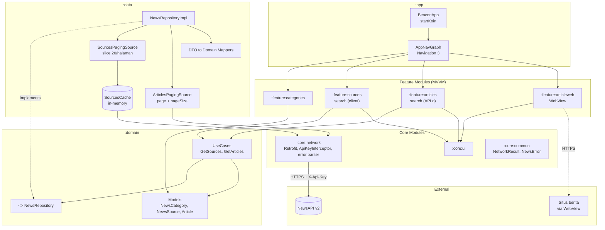
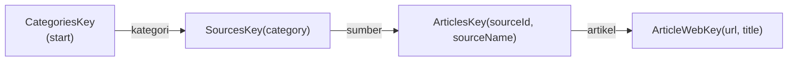
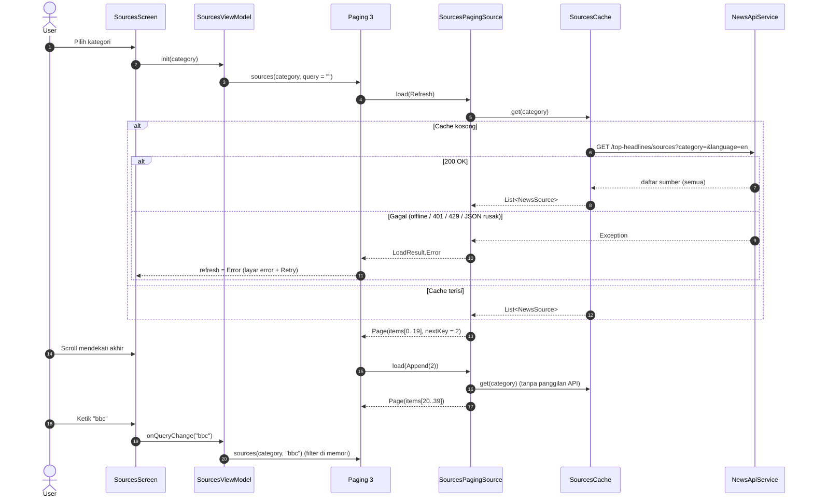
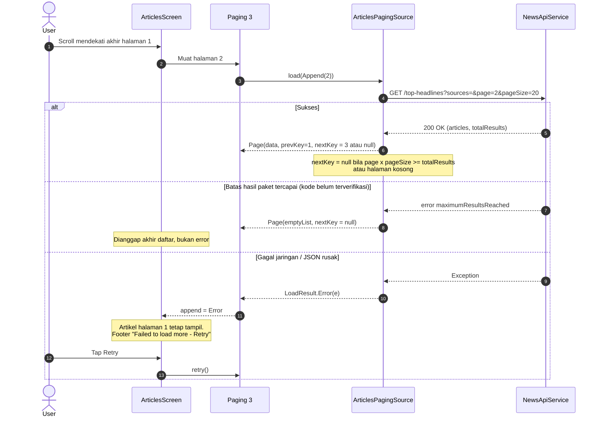
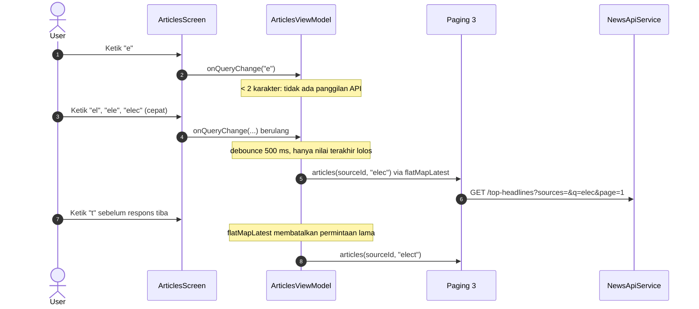
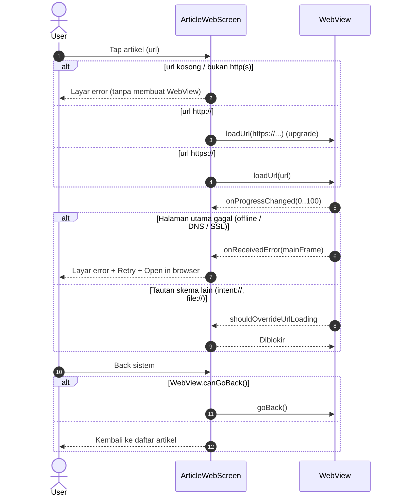

# Architecture & Engineering Decisions — Beacon (`ARCHITECTURE.md`)

## 1. Multi-Module Architecture & Dependency Rules

Aplikasi **Beacon** (`com.halimjr11.beacon`) menerapkan **Multi-Module Clean Architecture + MVVM** dengan *Unidirectional Data Flow (UDF)*. Struktur dan aturannya diturunkan dari pengalaman membangun **Katha** (aplikasi film TMDB), dengan penyesuaian untuk sifat NewsAPI (sources tanpa paginasi, kuota 100 request/hari, detail lewat `WebView`).

### A. Struktur Direktori Multi-Module

```text
Beacon/
├── app/                            # Application shell, MainActivity, AppNavGraph (Navigation 3), startKoin { ... }
├── core/
│   ├── common/                     # Android library tanpa UI: NetworkResult<T> + NewsError, DispatcherProvider, formatter tanggal
│   ├── network/                    # Android Library: OkHttp, ApiKeyInterceptor, Retrofit, NewsApiService, DTO, parser error, networkModule
│   └── ui/                         # Android Compose: BeaconTheme, FullScreenLoading, FullScreenError, PagingFooter, RemoteImage, SearchField
├── domain/                         # Android library tanpa UI (logika murni): Models, NewsRepository, UseCases, domainModule
├── data/                           # Android Library: NewsRepositoryImpl, Mappers, SourcesCache, PagingSources, dataModule
└── feature/
    ├── categories/                 # CategoriesScreen (statis)
    ├── sources/                    # SourcesScreen, SourcesViewModel (+search), sourcesModule
    ├── articles/                   # ArticlesScreen, ArticlesViewModel (+search, debounce), articlesModule
    └── articleweb/                 # ArticleWebScreen (WebView), WebUrlPolicy (fungsi murni: validasi, upgrade https, izin skema), ArticleWebViewModel (opsional)
```

Namespace Gradle: `com.halimjr11.beacon` (app) dan `com.halimjr11.beacon.<modul>` (modul lain, mis. `com.halimjr11.beacon.network`).

### B. Strict Dependency Matrix
* `:app` → mengoordinasikan seluruh modul untuk merakit navigasi dan mendaftarkan seluruh Koin modules.
* `:feature:*` → **hanya** `:domain`, `:core:ui`, `:core:common`. **Dilarang** mengakses `:data` atau `:core:network`.
* `:data` → `:domain`, `:core:network`, `:core:common`.
* `:domain` → `:core:common` (yang meng-expose `kotlinx-coroutines-core` dan bundle Koin lewat `api`) dan `androidx.paging:paging-common`. Tanpa Retrofit/OkHttp dan tanpa class Android.
* `:core:network` → `:core:common`.

### C. Modular System Architecture Diagram



### D. Strategi Koin Multi-Module
* **Desentralisasi:** `networkModule`, `dataModule`, `domainModule` (di `:domain`), `sourcesModule`, `articlesModule` (dan `articleWebModule` bila ada ViewModel).
* **Parameter runtime:** `viewModel { params -> SourcesViewModel(category = params.get(), getSources = get()) }` dipanggil dengan `parametersOf(...)`; kunci ViewModel unik per kategori/sumber (`key = "sources_$category"`).
* **Verifikasi:** `KoinModulesTest` di `:app` menggabungkan seluruh modul (`includes(...)`) dan menjalankan `verify(extraTypes = listOf(Int::class, String::class))`.

### E. Navigasi (Navigation 3)


Key `@Serializable` berada di `:app`; layar fitur menerima *callback* navigasi (tidak bergantung pada library navigasi).

---

## 2. Model Domain & Kontrak

```kotlin
enum class NewsCategory(val apiValue: String, val displayName: String) {
    Business("business", "Business"), Entertainment("entertainment", "Entertainment"),
    General("general", "General"), Health("health", "Health"), Science("science", "Science"),
    Sports("sports", "Sports"), Technology("technology", "Technology")
}

data class NewsSource(val id: String = "", val name: String = "", val description: String = "",
                      val category: String = "", val language: String = "", val country: String = "")

data class Article(val id: String = "", val sourceName: String = "", val author: String = "",
                   val title: String = "", val description: String = "", val url: String = "",
                   val imageUrl: String = "", val publishedAt: String = "", val content: String = "")

interface NewsRepository {
    fun sources(category: NewsCategory, query: String): Flow<PagingData<NewsSource>>
    fun articles(sourceId: String, query: String): Flow<PagingData<Article>>
}
```
Semua properti non-null dengan default; model berada satu file per class. Use case, satu file masing-masing: `GetSourcesUseCase`, `GetArticlesUseCase`. Kategori statis dibaca langsung dari `NewsCategory.entries` (tanpa use case, karena tidak ada logika).

### Model Error (`:core:common`)
```kotlin
sealed interface NewsError {
    data object Offline : NewsError
    data object InvalidApiKey : NewsError
    data object RateLimited : NewsError
    data object SourceNotFound : NewsError
    data class BadRequest(val message: String) : NewsError
    data object Server : NewsError
    data object Parse : NewsError
    data class Unknown(val message: String) : NewsError
}
```
`NetworkResult.Error` membawa `NewsError`; UI memetakan tipe ke pesan dan aksi (PRD §FR-07). Parser di `:core:network` membaca `code` dari body error.

**Jalur error ke UI (Paging).** `NewsRepository` hanya mengembalikan `Flow<PagingData>`, sedangkan Paging melaporkan kegagalan sebagai `Throwable` di `LoadState.Error`. Jembatannya:
```kotlin
class NewsException(val error: NewsError) : Exception()   // :core:common
fun Throwable.toNewsError(): NewsError =                   // :core:common
    (this as? NewsException)?.error ?: NewsError.Unknown(message.orEmpty())
```
* `safeCall` (repository) menghasilkan `NetworkResult`; kedua `PagingSource` membuka hasilnya: `Success` → `LoadResult.Page`, `Error(e)` → `LoadResult.Error(NewsException(e))`. `CancellationException` tetap di-*rethrow*.
* UI membaca `loadState.refresh/append` → `(error as Throwable).toNewsError()` lalu memetakan ke pesan dan aksi FR-07.

---

## 3. Sequence Diagrams

### A. Sumber: Fetch Sekali, Paginasi Klien, Pencarian



### B. Artikel: Endless Scroll, Error Append, Akhir Daftar



### C. Pencarian Artikel: Debounce dan Pembatalan



### D. Detail Artikel: Pemuatan WebView dan Error



---

## 4. Architecture Decision Records (ADR)

### ADR-001: Koin 4.2.2 dengan Constructor DSL
* **Context:** Proyek membutuhkan DI ringan lintas modul, mendukung `ViewModel` dengan parameter runtime.
* **Decision:** Koin (`singleOf`, `factoryOf`, `viewModel { params -> }`) terdesentralisasi per modul; `domainModule` berada di `:domain`.
* **Consequences:** (+) tanpa KSP/KAPT, build cepat. (−) resolusi saat runtime. *(Mitigasi: `KoinModulesTest` dengan `verify()`.)*

### ADR-002: Paging 3 untuk Sumber dan Artikel
* **Context:** US6 mewajibkan *endless scrolling* di sumber dan artikel, lengkap dengan kasus error.
* **Decision:** Keduanya memakai `PagingSource` → `Flow<PagingData<T>>` (`cachedIn(viewModelScope)`) → `collectAsLazyPagingItems()`.
* **Consequences:** (+) state `Refresh/Append`, retry, dan pembatalan sudah standar. (−) perlu footer khusus di `:core:ui`.

### ADR-003: Paginasi Sisi Klien untuk Sumber (Cache di Memori)
* **Context:** `/top-headlines/sources` tidak punya `page`/`pageSize` dan tidak punya `q`. Kuota hanya 100 request/hari.
* **Decision:** `SourcesCache` mengambil daftar sekali per kategori (dan bahasa), lalu `SourcesPagingSource` mengiris 20 item per halaman dari cache; pencarian memfilter daftar di memori sebelum diiris.
* **Consequences:** (+) memenuhi US6 dan US5 tanpa memboroskan kuota; rotasi dan kembali ke layar tidak memanggil API. (−) cache hilang saat proses mati (diterima; tanpa database sesuai ADR-008). Kegagalan tidak di-cache.

### ADR-004: Model Error Bertipe yang Dibaca dari Body
* **Context:** NewsAPI mengembalikan `{status, code, message}`; dokumentasi tidak memetakan kode ke status HTTP.
* **Decision:** Parser di `:core:network` membaca `code` dari body dan memetakan ke `NewsError`; status HTTP hanya cadangan. Repository memakai pola `safeCall` yang me-*rethrow* `CancellationException` dan menangkap `Exception` lain (JSON rusak dari Gson adalah `RuntimeException`).
* **Consequences:** (+) kasus negatif US7 tertangani dengan pesan tepat; pembatalan tidak berubah menjadi error. (−) kode yang belum terverifikasi (`maximumResultsReached`) harus diuji dengan panggilan nyata.

### ADR-005: Gson sebagai Converter JSON
* **Decision:** Retrofit + `GsonConverterFactory`; semua field DTO nullable dengan default `null` (supaya ada constructor tanpa argumen dan Gson tidak melewati nilai default); `@SerializedName` di baris sendiri; aturan R8 DTO di `consumer-rules.pro`.
* **Consequences:** (+) sederhana dan konsisten dengan Katha. (−) berbasis reflection dan tidak mengenal nullability Kotlin; ditutup dengan DTO nullable dan mapper yang defensif.

### ADR-006: Artikel dari `top-headlines` per Sumber
* **Decision:** `GET /top-headlines?sources=<id>&q=&page=&pageSize=20`. `sources` tidak boleh digabung `country`/`category`; alur kita memakai kategori hanya di layar sumber.
* **Consequences:** (+) satu endpoint untuk daftar dan pencarian. (−) hasil dibatasi paket; `/everything` (pencarian lebih dalam) ditunda.

### ADR-007: WebView yang Diperketat dengan Fallback Browser
* **Context:** US4 mewajibkan detail di web view; URL artikel bisa `http://`; Beacon memblokir cleartext.
* **Decision:** `WebView` dengan JavaScript aktif (dibutuhkan situs berita), `allowFileAccess=false`, `allowContentAccess=false`, mixed content ditolak, hanya skema `http/https`, progress dari `WebChromeClient`, error main-frame dari `WebViewClient.onReceivedError`, `BackHandler` untuk riwayat web, `destroy()` saat keluar. `http://` dicoba sebagai `https://`; bila gagal ditawarkan **Open in browser**.
* **Consequences:** (+) aman tanpa melonggarkan cleartext untuk seluruh aplikasi. (−) sebagian situs `http`-only tidak bisa dimuat di dalam aplikasi.

### ADR-008: Tanpa Database Lokal pada Iterasi Ini
* **Decision:** Tidak ada Room/`RemoteMediator`; cache sumber hanya di memori.
* **Consequences:** (+) fokus pada paginasi, pencarian, error. (Future) `:core:database` untuk mode offline.

### ADR-009: `:core:common` dan `:domain` sebagai Android Library Tanpa UI
* **Context:** Bundle `koin-android`/`koin-androidx-compose` berupa AAR sehingga tidak bisa dikonsumsi modul JVM murni.
* **Decision:** Kedua modul adalah Android library tanpa UI; `:core:common` meng-expose coroutines dan bundle Koin lewat `api`, sehingga `domainModule` berada di `:domain`.
* **Consequences:** (+) `domainModule` dekat dengan use case-nya. (−) `:domain` bukan JVM murni; larangan memakai class Android di `:domain` menjadi konvensi, bukan batasan compiler.

### ADR-010: API Key via Header dan `local.properties`
* **Decision:** `NEWS_API_KEY` di `local.properties` (di-ignore Git) → `BuildConfig` → header `X-Api-Key` oleh `ApiKeyInterceptor`. Logging OkHttp memakai level `BASIC` di debug dan `NONE` di release; header sensitif tidak dicatat.
* **Consequences:** (+) kunci tidak masuk repo dan tidak muncul di URL. (−) kunci tetap dapat diekstrak dari APK; untuk produksi pertimbangkan proxy backend.

### ADR-011: Pencarian Artikel dengan Debounce dan `flatMapLatest`
* **Decision:** `query` di `ArticlesViewModel` → `debounce(500 ms)` → petakan query < 2 karakter (setelah `trim`) menjadi `""` (daftar default, tanpa panggilan API pencarian; sesuai AC 5.8) → `distinctUntilChanged` → `flatMapLatest { repository.articles(sourceId, it) }` → `cachedIn`. Pencarian sumber tidak memakai debounce karena murni lokal.
* **Consequences:** (+) hemat kuota, tanpa hasil basi. (−) pengujian perlu *virtual time* (`runTest` + Turbine).

### ADR-012: Struktur Modul Berbasis Lapisan dan Fitur
* **Decision:** `:core:*`, `:domain`, `:data`, `:feature:*` seperti Katha; satu file per class model/use case; satu komponen daftar paging bersama di `:core:ui` bila pola loading/error/footer berulang.
* **Consequences:** (+) batas dependensi ditegakkan compiler. (−) konfigurasi Gradle awal lebih banyak (dimitigasi version catalog).

---

## 5. Build, Keamanan & Rilis
* **Toolchain:** AGP 9.x tanpa plugin `org.jetbrains.kotlin.android` (Kotlin sudah built-in), Kotlin 2.4.x, JDK 17, Gradle version catalog.
* **R8:** aktif pada `release` dengan `-obfuscationdictionary`, `-repackageclasses ''`, dan `consumer-rules.pro` untuk DTO. Setelah build, periksa `mapping.txt` memastikan class sendiri benar-benar teracak.
* **Network security config:** `cleartextTrafficPermitted="false"`; satu-satunya pengecualian adalah `network_security_config.xml` di source set `debug` yang mengizinkan cleartext hanya ke `10.0.2.2` (server tiruan QA). Release tidak memiliki pengecualian.
* **Base URL uji:** `NEWS_API_BASE_URL` opsional di `local.properties` → `BuildConfig` (default `https://newsapi.org/v2/`; hanya dibaca di build debug). Dipakai untuk mengarahkan QA manual ke MockWebServer/server tiruan (lihat Test Plan §1) agar kasus kuota habis, sumber hilang, kosong, dan field null bisa dipicu.
* **Catatan paket NewsAPI:** paket Developer hanya untuk dev/testing; rilis publik membutuhkan paket berbayar.

## 6. Strategi Testing & Status

| Lapisan | Alat | Cakupan |
|---|---|---|
| Unit: `:core:common` | JUnit 5 `@ParameterizedTest` | Formatter tanggal, `NetworkResult` |
| Unit: `:core:network` | JUnit 5, MockK | Interceptor header, parser error (semua `code`, body rusak), parsing DTO |
| Unit: `:domain` | JUnit 5, MockK, Turbine | Use case meneruskan argumen dan hasil |
| Unit: `:data` | JUnit 5, MockK, `asSnapshot` | Mapper, `SourcesCache`, kedua `PagingSource`, repository, cancellation |
| Unit: `:feature:*` | JUnit 5, Turbine | ViewModel: loading → data, pencarian, debounce, retry |
| DI | Koin `verify` | Graf lintas modul |
| Manual | Emulator + `adb` | Alur 4 layar, scroll, cari, offline, kunci salah, WebView |
| Compose UI & instrumented (`androidTest`) | – | **Segera ditambahkan** (tetap JUnit 4) |

Detail kasus uji ada di [test_plan_and_qa.md](test_plan_and_qa.md).
